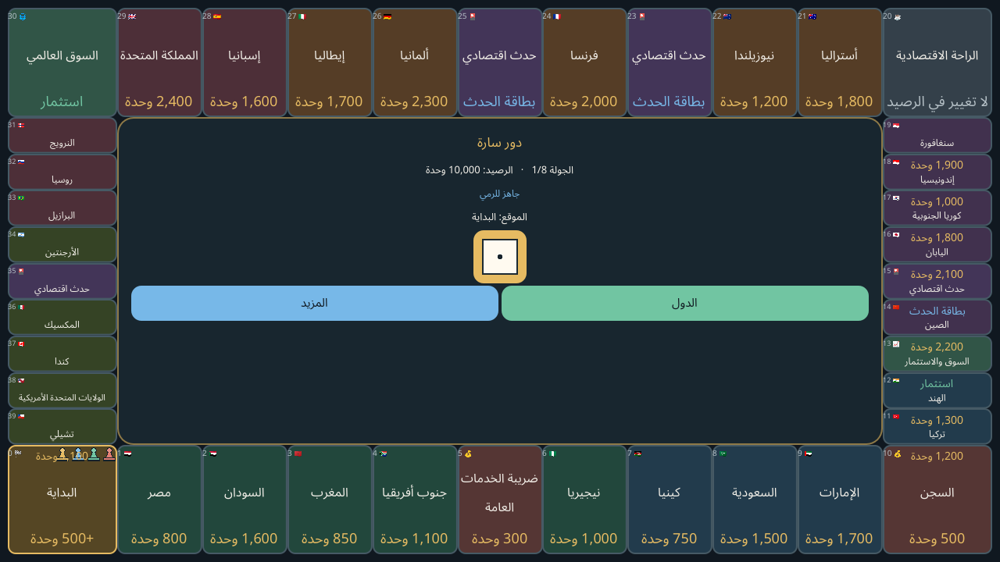
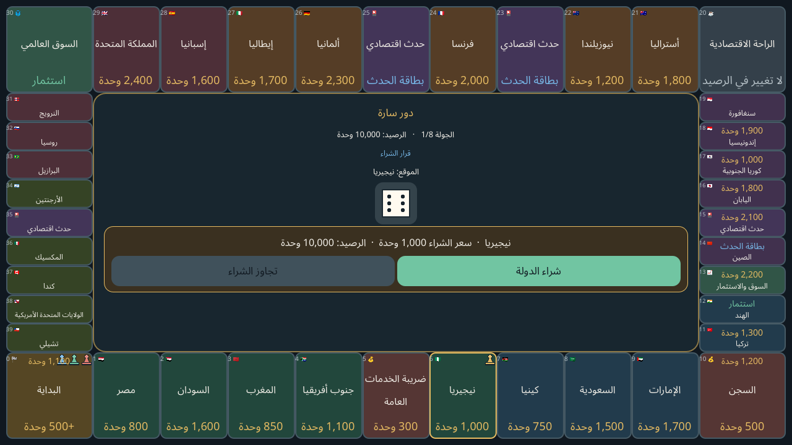
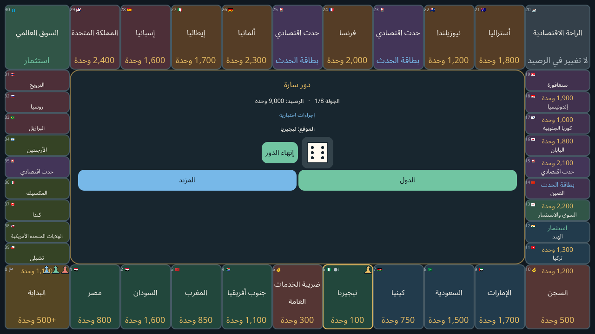
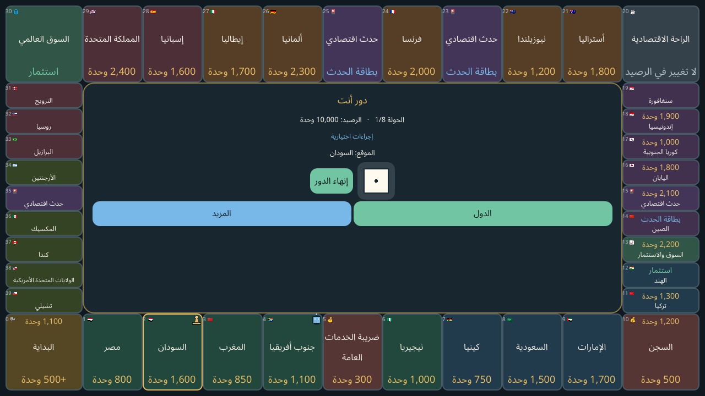

# بنك الحظ 1.0.6

لعبة لوحية اقتصادية بالعربية مبنية بـGodot 4.7.2 وتعمل دون اتصال بالإنترنت. تضم لوحة من 40 خانة و30 دولة، واللعب ضد الكمبيوتر بثلاث درجات أو اللعب المحلي بالتناوب من لاعبين إلى أربعة على الهاتف نفسه. تدعم العربية والإنجليزية والإسبانية والفرنسية، وتُقفل أفقيًا على Android.

هذا المستودع خاص. الملفات القابلة للتنزيل موجودة في إصدار GitHub:

- [تحميل APK Android 1.0.6](https://github.com/mojtabahamed163-ai/luckbank/releases/download/v1.0.6/luckbank-1.0.6.apk)
- [تحميل مصدر اللعبة والاختبارات](https://github.com/mojtabahamed163-ai/luckbank/releases/download/v1.0.6/luckbank-source-1.0.6.zip)
- [تحميل صور اللعب](https://github.com/mojtabahamed163-ai/luckbank/releases/download/v1.0.6/luckbank-gameplay-images-1.0.6.zip)
- [صفحة إصدار 1.0.6 وملاحظاته](https://github.com/mojtabahamed163-ai/luckbank/releases/tag/v1.0.6)

## صور من داخل اللعبة

**لوحة الأربعين خانة، والبداية أسفل اليسار، والنرد السداسي:**



**أثناء اللعب وبعد الرمية وقرار شراء دولة:**



**بعد شراء دولة:**



**شكل قطعة اللاعب البشري مقارنة بقطعة الكمبيوتر:**



هذه الصور لقطات فعلية من تشغيل اللعبة على Linux/X11 بدقة 1280×720، وليست صورًا ملتقطة من هاتف Android.

## تغييرات 1.0.6

- تبديل موضعي الخانتين: السجن في مكان الراحة السابقة (الخانة 10) بكفالة 500 وحدة، والراحة الاقتصادية في مكان ضريبة الخزانة السابقة (الخانة 20) دون تغيير للرصيد.
- وضع خانة البداية أسفل اليسار، واعتماد نرد سداسي مرئي بوجوه من 1 إلى 6 بدل الاكتفاء بعبارة رمي النرد.
- إضافة قطع حركة مميزة بصريًا: بيدق للاعب البشري وروبوت للكمبيوتر، وتتحرك القطعة على البلاطات لتوضيح الموضع الحالي.
- توحيد ترقيم الخانات دون أصفار بادئة، وإبراز مبالغ الدول بوضوح، مع تكبير رموز القطع قليلًا واستخدام أسماء كاملة.
- تبسيط وسط اللعب ليعرض المعلومات الأساسية؛ الضغط على أي خانة يفتح تفاصيلها، وقائمة «الدول» تعرض ممتلكات صاحب الدور فقط، وتبقى بقية الخيارات ضمن «المزيد».

## ما تتضمنه اللعبة

- لوحة 40 خانة و30 دولة بالقيم الاقتصادية المحددة، وست مجموعات دول، وتطوير حتى ثلاثة مستويات.
- استثمارات متعددة وتوسعات مدفوعة للزراعة والثروة الحيوانية في السودان وميزات وطنية وأحداث اقتصادية.
- إيجارات ودخول دورية وضرائب وديون وتسوية والتصفية والإفلاس والصفقات وحفظ محلي للمباراة.
- خصم حاسوبي بثلاث درجات، ولعب محلي بالتناوب من 2 إلى 4 لاعبين على جهاز واحد.
- واجهة عربية افتراضيًا وRTL، إلى جانب الإنجليزية والإسبانية والفرنسية؛ بلا إعلانات أو اتصال شبكي.

## التثبيت والتوافق

APK موقّع بتوقيع Debug للتثبيت اليدوي، وليس إصدار متجر. يضم ARMv7 وARM64، ويطلب Android API 24 على الأقل، ولا يطلب إذن الإنترنت. ملف Manifest يقفل العرض على Landscape. يُتوقع توافقه مع Infinix SMART 7 HD، لكن لم يُختبر على ذلك الهاتف مباشرة؛ راجع [تقرير التحقق](docs/verification-1.0.6.md).

## فتح المشروع والاختبارات

افتح `project.godot` في Godot 4.7.2. لتشغيل اختبارات القواعد والاقتصاد:

```bash
godot --headless --path . --scene res://test/test_suite.tscn
```

فحص واجهة X11 بدقة 1280×720 يحتاج Xvfb لأن Godot headless يعطّل نظام العرض:

```bash
xvfb-run -a -s '-screen 0 1400x900x24' \
  godot --path . --windowed --resolution 1280x720 \
  --script res://test/ui_smoke.gd
```

اجتازت اختبارات القواعد والاقتصاد **1302/1302**، ونجح اختبار الواجهة في اللغات الأربع، بما يشمل القوائم والتفاصيل والنرد وموضع البداية. لم يُختبر تثبيت APK على جهاز Android فعلي. صدّر Android من preset `Android` باستخدام قالب Godot المطابق وJDK وAndroid SDK؛ تفاصيل بيئة البناء وتحذير Build-Tools 29.0.3 موجودة في [سجل بيئة البناء](docs/android-build-environment.md).

## سجل التغيير والترخيص

- [ملاحظات إصدار 1.0.6](docs/release-notes-v1.0.6.md)
- [تقرير التحقق والتوافق 1.0.6](docs/verification-1.0.6.md)
- [ملاحظات إصدار 1.0.5](docs/release-notes-v1.0.5.md)
- [تقرير التحقق 1.0.5](docs/verification-1.0.5.md)
- واجهة اللعب تستخدم Noto Sans Arabic لقراءة واضحة؛ ملفات التراخيص مرفقة في `assets/fonts/`.
