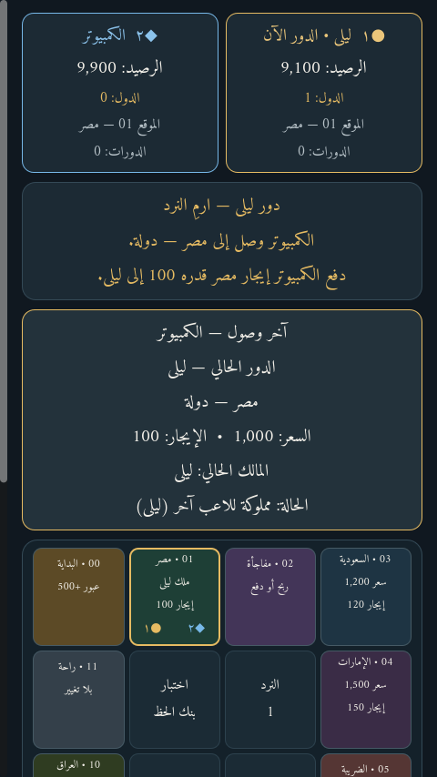
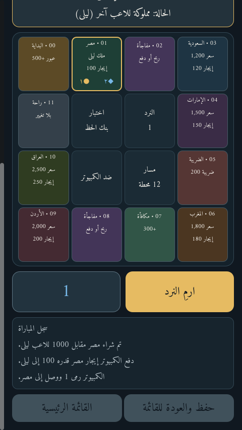
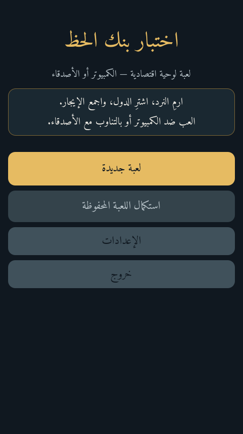
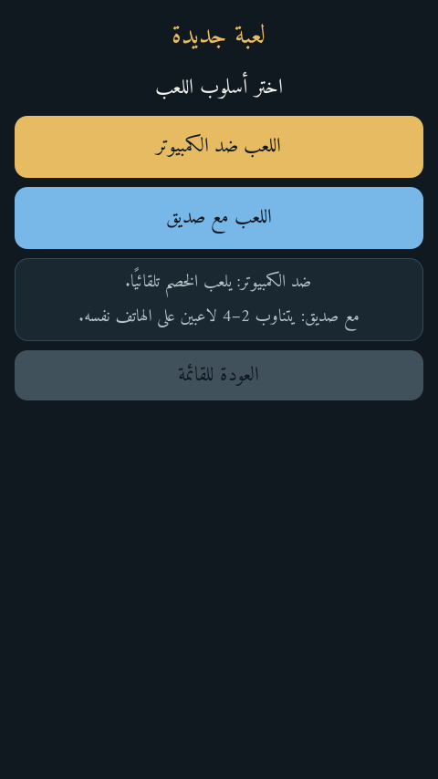
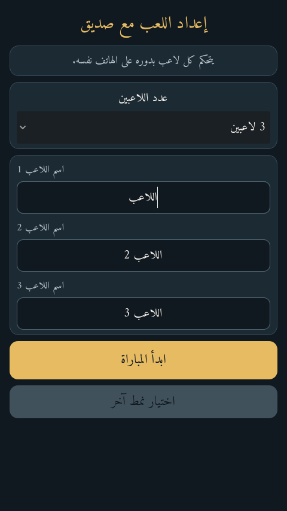

# اختبار بنك الحظ

لعبة لوحية اقتصادية بالعربية، مبنية باستخدام **Godot 4.7.2 وGDScript**. العب ضد الكمبيوتر أو بالتناوب المحلي بين **2–4 لاعبين** على جهاز واحد. لا تحتاج اللعبة إلى اتصال بالإنترنت.

هذا المستودع خاص افتراضيًا. ملفات التثبيت والمصدر المضغوط متاحة في إصدار GitHub:

- [تنزيل APK لأندرويد — الإصدار 1.0.2](https://github.com/mojtabahamed163-ai/luckbank/releases/download/v1.0.2/luckbank-universal-debug.apk)
- [تنزيل ZIP للمصدر والأصول والاختبارات](https://github.com/mojtabahamed163-ai/luckbank/releases/download/v1.0.2/luckbank-source.zip)
- [صفحة إصدار 1.0.2](https://github.com/mojtabahamed163-ai/luckbank/releases/tag/v1.0.2)

الـAPK عالمي ويضم معماريتي **ARMv7 (32 بت)** و**ARM64 (64 بت)**، والحد الأدنى Android 7 / API 24. لا يطلب إذن الإنترنت. توقيعه Debug للتثبيت اليدوي، وليس للنشر في متجر Google Play.

## صور من اللعبة

**مباراة فعلية:** وصل الكمبيوتر إلى مصر ودفع الإيجار لليلى.

**اللوحة وسجل اللعب وزر رمي النرد أثناء المباراة:**

**القائمة واختيار النمط وإعداد لعبة الأصدقاء:**

| القائمة الرئيسية | اختيار نمط اللعب | إعداد اللاعبين |
|---|---|---|
|  |  |  |

## اللعبة

لوحة من 12 محطة، نرد وحركة دائرية ومكافأة لعبور البداية، ست دول بأسعار وإيجارات، شراء وملكية وإيجار، أحداث وضريبة ومكافآت، إفلاس ونهاية للمباراة، أسماء ومواقع وأرصدة وعدد الدول لكل لاعب. تظهر بطاقة المحطة والدولة وسعرها وإيجارها ومالكها. تتوفر إعدادات سرعة الكمبيوتر وحفظ المباراة واستكمالها محليًا.

## البناء والاختبارات

1. افتح `project.godot` في Godot 4.7.2.
2. شغّل اللعبة من المحرك أو نفّذ `godot --path .`.
3. اختبارات القواعد الحتمية: `godot --headless --path . --scene res://test/test_suite.tscn`.
4. اختبارات الواجهة واستعادة الحفظ موجودة في `tools/ui_smoke.gd` و`tools/resume_smoke.gd`؛ تتطلب Xvfb على Linux.

يتضمن `docs/verification-1.0.2.md` تقرير خصائص اللعبة والبناء والاختبارات والحدود. لم يُثبت الإصدار على هاتف Android فعلي أثناء إعداد هذا المستودع. ترخيص الخط العربي المضمّن موضح في `assets/fonts/Amiri-OFL.txt`.