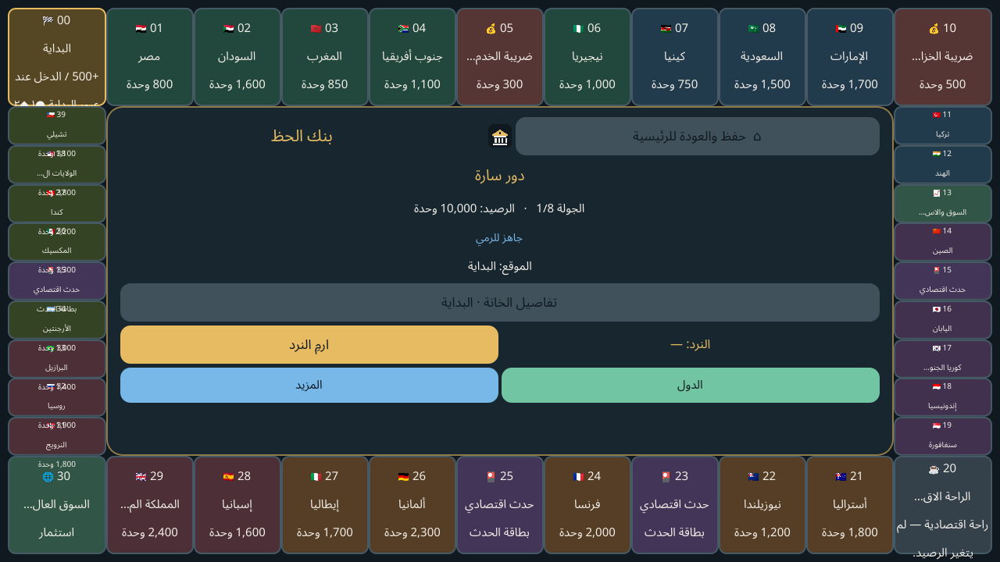
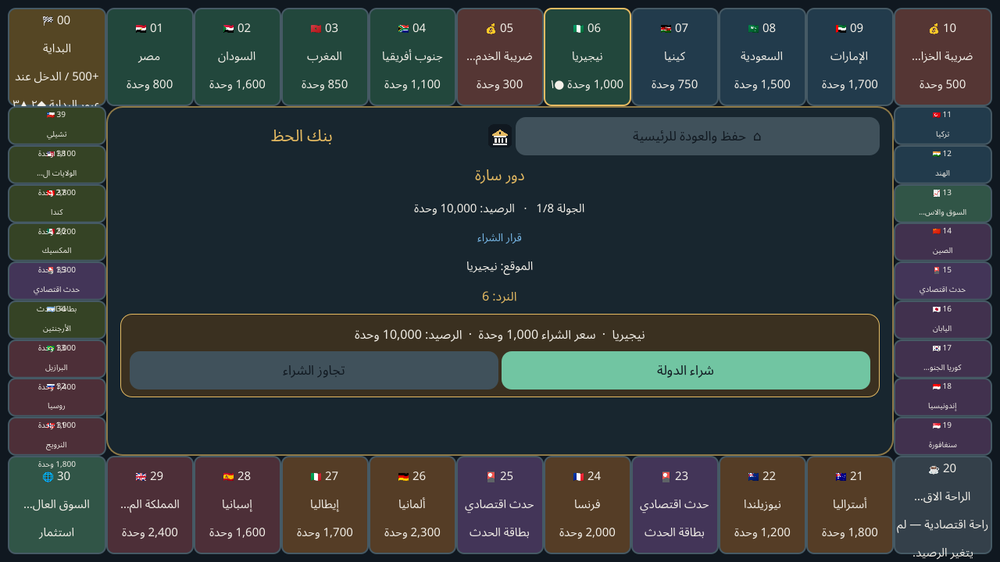
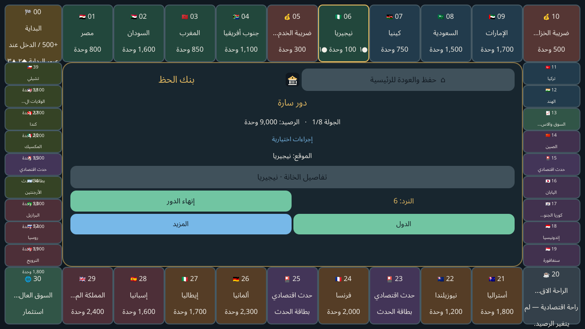

# بنك الحظ 1.0.5

لعبة لوحية اقتصادية بالعربية مبنية بـGodot 4.7.2، تعمل دون اتصال بالإنترنت. اللوحة 40 خانة و30 دولة، مع لعب ضد الكمبيوتر بثلاث درجات أو لعب محلي بالتناوب من لاعبين إلى أربعة. تدعم العربية والإنجليزية والإسبانية والفرنسية، وتُقفل أفقيًا على Android.

هذا المستودع خاص. الملفات القابلة للتنزيل موجودة في إصدار GitHub:

- [تحميل APK Android 1.0.5](https://github.com/mojtabahamed163-ai/luckbank/releases/download/v1.0.5/luckbank-1.0.5.apk)
- [تحميل مصدر اللعبة والاختبارات](https://github.com/mojtabahamed163-ai/luckbank/releases/download/v1.0.5/luckbank-source-1.0.5.zip)
- [تحميل صور اللعب](https://github.com/mojtabahamed163-ai/luckbank/releases/download/v1.0.5/luckbank-gameplay-images-1.0.5.zip)
- [صفحة إصدار 1.0.5 وملاحظاته](https://github.com/mojtabahamed163-ai/luckbank/releases/tag/v1.0.5)

## صور من داخل اللعبة

**لوحة الأربعين خانة على الوضع الأفقي:**



**أثناء اللعب بعد رمية النرد:**



**بعد شراء دولة:**



تُظهر هذه الصور تشغيلًا فعليًا على Linux/X11 بدقة 1280×720، وليست لقطات ملتقطة من هاتف Android.

## ما يتضمنه الإصدار

- 40 خانة و30 دولة بالقيم الاقتصادية المحددة، وست مجموعات دول، وتطوير حتى ثلاثة مستويات.
- استثمارات متعددة مع توسعات مدفوعة للزراعة والثروة الحيوانية في السودان، وميزات وطنية وأحداث اقتصادية.
- إدارة الضرائب والإيجارات والديون والتصفية والإفلاس والصفقات، وحفظ واستكمال المباراة محليًا.
- أوضاع اللاعب ضد الكمبيوتر بثلاث درجات، واللعب المحلي من 2–4 لاعبين.
- 8 أو 16 أو 24 جولة للمدد السريعة والعادية والطويلة. المدة بالدقائق لم تُقَس على هاتف، وبطاقات الاقتصاد في هذه النسخة ذات آثار تلقائية/مشروطة وليست اختيارات تفاعلية.

## التثبيت والتوافق

APK موقّع بتوقيع Debug للتثبيت اليدوي، وليس إصدار متجر. يضم ARMv7 وARM64، ويطلب Android API 24 على الأقل، ولا يطلب إذن الإنترنت. ملف Manifest يقفل العرض على Landscape. يُتوقع توافقه مع Infinix SMART 7 HD بحسب المواصفات المنشورة، لكن لم يُختبر على ذلك الهاتف مباشرة؛ راجع [تقرير التحقق](docs/verification-1.0.5.md).

## فتح المشروع والاختبارات

افتح `project.godot` في Godot 4.7.2. اختبارات القواعد والاقتصاد والتعريب:

```bash
godot --headless --path . --scene res://test/test_suite.tscn
```

فحص واجهات X11 عند 1280×720 يحتاج Xvfb لأن Godot headless يعطّل نظام العرض:

```bash
xvfb-run -a -s '-screen 0 1400x900x24' \
  godot --path . --windowed --resolution 1280x720 \
  --script res://test/ui_smoke.gd
```

نجحت اختبارات القواعد والاقتصاد **1265/1265**، كما نجح فحص واجهة اللوحة وقوائم الممتلكات والمزيد وتفاصيل الخانات في أربع لغات. تعذرت تجربة تثبيت APK على جهاز Android فعلي. صدّر Android من preset `Android` باستخدام قالب Godot المطابق وJDK وAndroid SDK؛ تفاصيل البيئة وتحذير Build-Tools 29.0.3 موجودة في [سجل بيئة البناء](docs/android-build-environment.md).

## سجل التغيير والترخيص

- [ملاحظات إصدار 1.0.5](docs/release-notes-v1.0.5.md)
- [ملاحظات إصدار 1.0.4](docs/release-notes-v1.0.4.md)
- [تقرير التحقق والتوافق](docs/verification-1.0.5.md)
- واجهة اللعب تستخدم Noto Sans Arabic لقراءة واضحة؛ ترخيصه وترخيص Amiri وNoto Color Emoji مرفقة في `assets/fonts/`.
